# 혼디가개 기능 소개

> 반려견과 함께하는 제주 여행 — 동반 가능한 장소를 찾고, 오늘 나가도 되는지 판단하고, AI 로 일정을 짜서 다듬고, 여행 당일 브리핑까지 받는 서비스입니다.
>
> 아래 GIF 는 **운영 서버(`www.hondigagae.com`)를 Playwright 로 직접 조작해 녹화**했습니다(2026-10-13 낮, 공모전 테스트 계정).
> 반려견은 **보리**(웰시코기 · 중형견 · 더위 민감)와 이번에 새로 등록한 **몽실이**(말티즈 · 소형견 3.2kg · 추위 민감)입니다.
> 각 GIF 아래 자막이 지금 무엇을 하는 단계인지 알려 주고, 주황 테두리는 설명하는 자리입니다. AI 가 기다리는 구간은 빨리 감았습니다.

[← README 로 돌아가기](../README.md)

## 한눈에 보는 사용 흐름

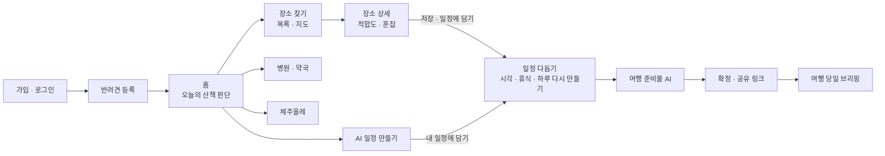

## 목차

1. [회원 — 가입 · 로그인 · 비밀번호 찾기](#1-회원--가입--로그인--비밀번호-찾기)
2. [반려견 등록](#2-반려견-등록)
3. [홈 — 오늘 산책해도 될까](#3-홈--오늘-산책해도-될까)
4. [장소 찾기 — 목록과 지도](#4-장소-찾기--목록과-지도)
5. [장소 상세 — 이 아이와 가도 되는지 · 저장 · 일정에 담기](#5-장소-상세--이-아이와-가도-되는지--저장--일정에-담기)
6. [AI 일정 만들기](#6-ai-일정-만들기)
7. [일정 다듬기 — 동선 · 시각 · 휴식 · 하루 다시 만들기](#7-일정-다듬기--동선--시각--휴식--하루-다시-만들기)
8. [여행 준비물 (AI)](#8-여행-준비물-ai)
9. [일정 확정 · 공유 링크](#9-일정-확정--공유-링크)
10. [여행 당일 브리핑](#10-여행-당일-브리핑)
11. [병원 · 약국](#11-병원--약국)
12. [제주올레 산책 코스](#12-제주올레-산책-코스)
13. [모바일](#13-모바일)
14. [내 정보](#14-내-정보)
15. [운영 E2E 점검 결과 (2026-10-13)](#운영-e2e-점검-결과-2026-10-13)

---

## 1. 회원 — 가입 · 로그인 · 비밀번호 찾기

| 이메일 회원가입 | 비밀번호 찾기 |
| --- | --- |
| 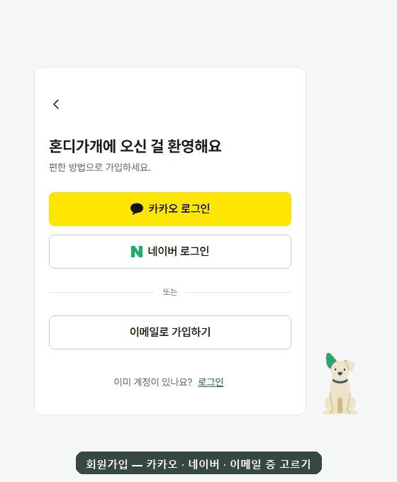 | 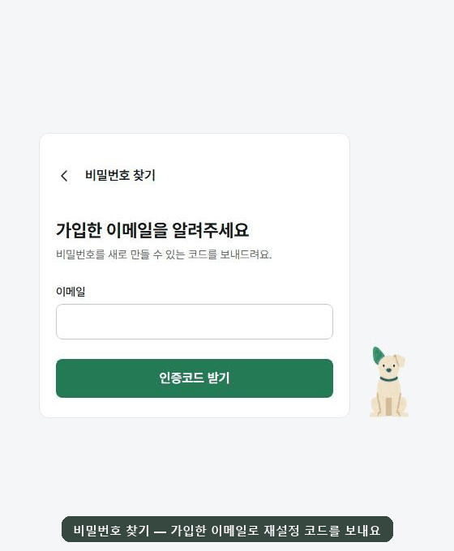 |

**회원가입 흐름** — `가입 방법 고르기 → 1단계 이메일 → 약관 시트 → 2단계 인증코드 → 3단계 프로필`

- 카카오 · 네이버 소셜 가입과 이메일 가입을 고릅니다.
- **인증코드 받기**를 누르면 약관 시트가 먼저 뜹니다. 필수 3개(이용약관 · 개인정보 처리방침 · 만 14세 이상)에 동의해야 코드를 보냅니다.
- 2단계에는 **만료까지 남은 시간(5분)** 과 **재발송 대기 시간(60초)** 이 초 단위로 줄어듭니다. 서버가 `codeExpiresInSeconds` · `resendAvailableInSeconds` 를 내려 줍니다.
- 틀린 코드는 입력란 아래에 `인증코드가 일치하지 않습니다.` 로 알려 줍니다.
- **가입 여부를 드러내지 않습니다.** 이미 가입한 이메일로 코드를 받아도 같은 화면으로 넘어갑니다(계정 열거 방지).

**비밀번호 찾기** — 가입한 이메일로 재설정 코드를 보내고, 코드와 새 비밀번호(8~20자, 영문 · 숫자 · 특수문자)를 한 화면에서 입력합니다. 여기서도 이메일 존재 여부와 상관없이 같은 문구가 나옵니다.

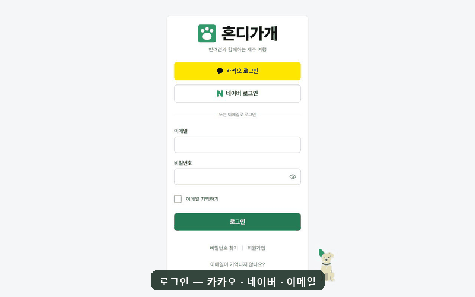

- **로그인** — 비밀번호가 틀리면 `이메일 또는 비밀번호가 올바르지 않습니다` 를 보여 주고, 맞게 입력하면 홈으로 갑니다. 이메일 기억하기를 지원합니다.

## 2. 반려견 등록

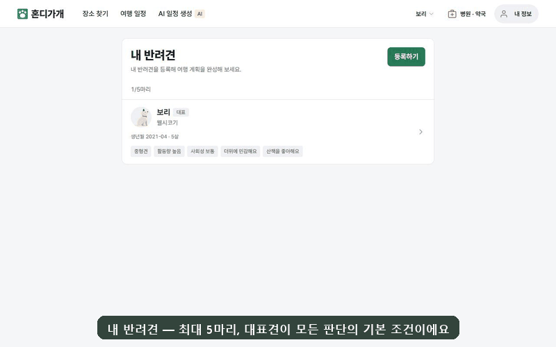

**흐름** — `내 반려견 → 등록하기 → 기본 정보 → 성향 · 민감도 → 등록`

- 최대 **5마리**까지 등록하고 **대표견**을 정합니다. 대표견이 홈 판단 · 장소 필터 · AI 일정의 기본 조건이 됩니다.
- 기본 정보는 이름 · 품종 · 생년월(숫자만 입력하면 `2022-06` 로 맞춰짐) · 체중입니다. **체중을 적으면 크기(소형 · 중형 · 대형)가 저절로 맞춰지고**, 장소의 입장 체중 제한을 안내할 때 씁니다.
- 성향은 활동량 · 사회성 · 산책 선호, 민감도는 더위 · 추위 · 소음입니다. 장소 적합도 · 산책 위험도 · AI 일정 · 준비물이 이 값을 조건으로 읽습니다.

## 3. 홈 — 오늘 산책해도 될까

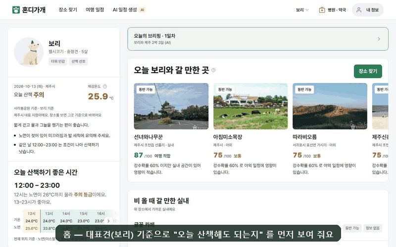

- **오늘 산책 판단** — 대표견 기준으로 `오늘 산책 주의` 같은 등급을 냅니다. 체감온도와 추정 노면(아스팔트) 온도, 그날 더 나은 시간대를 함께 보여 줍니다.
- **오늘 산책하기 좋은 시간** — 기상청 시간별 예보로 노면 온도를 계산해 `12:00 – 23:00` 처럼 구간을 냅니다. 시간대별 기온 · 노면 온도 표가 함께 나옵니다.
- **오늘 ○○와 갈 만한 곳** — 날씨 · 동반 조건 · 혼잡을 묶은 **적합도 상위 10곳**을 가로 레일로 넘겨 봅니다(예: 선녀와나무꾼 87점 "여행 적합").
- **비 올 때 갈 만한 실내** · AI 일정 · 제주올레 · 동물병원 바로가기 · 다가오는 일정 · **오늘 나가기 좋은 권역**(제주시 · 서귀포 · 동부 · 서부)이 이어집니다.
- **헤더에서 반려견을 바꾸면** 판단과 추천이 그 아이 기준으로 다시 계산됩니다. 몽실이로 바꾸자 추천 순위가 한림공원 87 · 선녀와나무꾼 87 · 캠퍼트 84 로 바뀌었습니다.
- 여행 당일에는 맨 위에 **오늘의 브리핑** 배너가 뜹니다([10. 브리핑](#10-여행-당일-브리핑)).

## 4. 장소 찾기 — 목록과 지도

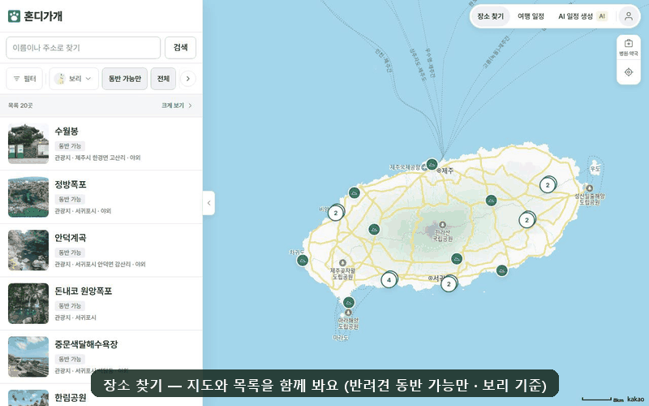

**흐름** — `지도 + 목록 → 유형 · 검색 → 목록에서 고르기 → 지도 미리보기 → 지도 옮기고 재검색 → 목록 크게 보기`

- 공공데이터(TourAPI · 한국문화정보원 · 식약처)를 미리 적재하고, 원천 간 같은 장소를 하나로 합쳐 보여 줍니다. 기본은 **반려견 동반 가능만**입니다.
- **유형**(관광지 · 음식점 · 카페 · 숙박 · 문화시설 · 레포츠 · 축제 · 쇼핑 · 여행코스) · 이름 · 주소 검색 · **반려견 칩**(그 아이의 체구로 필터)으로 거릅니다.
- 목록에서 고르면 **지도 미리보기 패널**에 사진 · 동반 조건 · 오늘 판단 · 길찾기 · 저장이 나옵니다.
- 지도를 옮기면 **이 지역에서 재검색**이 뜨고, **병원 · 약국 함께 보기**로 동물병원 · 약국 핀을 겹쳐 봅니다.
- **목록 크게 보기**는 사진 카드와 커서 기반 무한 스크롤입니다.

## 5. 장소 상세 — 이 아이와 가도 되는지 · 저장 · 일정에 담기

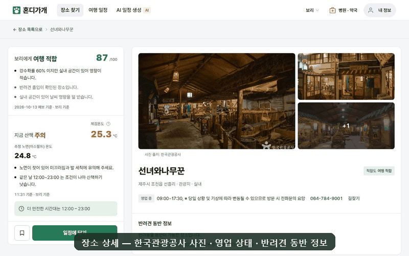

- **보리에게 여행 적합 87/100** — 근거 문장을 함께 냅니다(예: "강수확률 60% 이지만 실내 공간이 있어 영향이 적습니다", "반려견 출입이 확인된 장소입니다").
- **지금 산책 위험도** — 체감온도 · 추정 노면 온도와 `더 안전한 시간대는 12:00 – 23:00` 같은 안내를 냅니다.
- **언제 가면 덜 붐빌까** — 관광빅데이터 집중률로 30일 혼잡을 예측해 가장 덜 붐비는 날을 알려 줍니다(예: "10월 30일(금) 집중률 38 · 평균보다 28 낮아요"). 7일만 보기도 됩니다.
- **방문 정보** — 운영시간 · 휴무 · 전화 · 홈페이지 · 주소 · 주차 · 위치 지도 · 한국관광공사 사진입니다.
- **저장(찜)** 한 곳은 AI 일정이 먼저 넣어 봅니다.
- **일정에 담기**는 `어디에 담을까요? → 며칠에 담을까요?` 순서로 고릅니다. 담으면 `선녀와나무꾼을 1일차 15:00에 담았어요` 처럼 추천 시각까지 넣고 알려 줍니다. 새 일정을 만들어 담을 수도 있습니다.

## 6. AI 일정 만들기

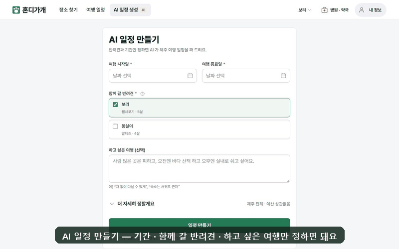

**흐름** — `기간 · 반려견 · 하고 싶은 여행 → 더 자세히(지역 · 예산 · 저장한 곳 · 꼭 넣을 장소) → 일정 만들기 → 진행 화면 → 초안 → 내 일정에 담기`

- 조건은 **기간 · 함께 갈 반려견(여러 마리) · 하고 싶은 여행**(자유 문장)만 정하면 됩니다. "더 자세히 정할게요" 에서 지역(제주 전체 · 제주시 · 서귀포시) · 예산 · **저장한 곳 먼저 넣기** · **꼭 넣을 장소(최대 10)** 를 고릅니다.
- 제출하면 서버가 작업을 받고(`202 Accepted` + `jobId`), 진행 화면이 경과 시간과 단계를 실시간(SSE, 폴링 폴백)으로 보여 줍니다. LLM 은 사내 GPU 서버의 **Ollama `gpt-oss:20b`** 이고, 이번 녹화에서는 **2분 23초** 걸렸습니다.
- 서버가 반려견 동반 가능 후보를 권역마다 골라 주고, 결과를 서버 사실로 다시 검증합니다. 후보 밖 장소 제거 · 같은 장소 반복 교체 · 권역 이탈 교체 · 숙소 재배치를 합니다.
- 초안은 바로 저장되지 않습니다. 제목을 고치고 **내 일정에 담기**를 눌러야 내 일정(초안)이 되고, 항목마다 추천 시각이 들어갑니다. 전체 다시 만들기 · 버리기도 됩니다.

**이번에 실제로 받은 초안** — 조건: 10/15(목)~10/17(토) 2박 3일 · 보리 + 몽실이 · 예산 30만원 · 저장한 곳 먼저 · "오전엔 바다 보며 산책하고, 오후엔 실내에서 쉬고 싶어요. 숙소는 서귀포 쪽이면 좋겠어요."

| 일차 | 장소 | 식사 · 숙박 | AI 가 붙인 이유 |
| --- | --- | --- | --- |
| 1일차 | 곽지해수욕장 (애월 · 야외) | 당당 (카페 · 실내) → 어반컨트리 (숙박) | 곽지해수욕장 산책 · 카페 실내 휴식 |
| 2일차 | 수월봉 (고산 · 야외) → 테디베어뮤지엄 제주 (실내) | 제쥬엔 (안덕 · 숙박) | 수월봉 산책 · 실내 관람 |
| 3일차 | 외돌개 (서귀포 · 야외) → 한림공원 (실내) | — | 외돌개 산책 · 실내 박물관 관람 |

- "오전엔 바다 산책 · 오후엔 실내" 는 지켰습니다. "숙소는 서귀포 쪽" 은 2일차만 맞았습니다.
- 3일차 한림공원은 **7kg 이하만 입장**이라 중형견 보리는 들어가기 어렵습니다. 일정 상세의 3일차 적합도가 `주의 필요` 로 알려 주지만, 서버가 처음부터 걸러야 할 장소입니다 → [#1420](https://github.com/8llow8llowMe/hondigagae/issues/1420).

## 7. 일정 다듬기 — 동선 · 시각 · 휴식 · 하루 다시 만들기

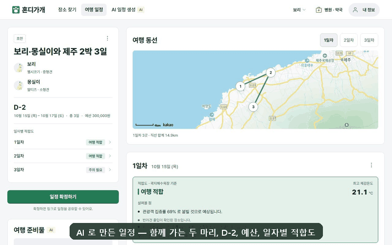

- **개요** — 함께 가는 반려견 · D-day · 기간 · 예산 · **일자별 적합도**(1일차 여행 적합 · 3일차 주의 필요 같은 요약)를 봅니다.
- **여행 동선** — 일자별 방문 순서를 지도에 선으로 잇고 직선 거리 합계(예: 1일차 3곳 · 14.9km)를 보여 줍니다.
- **일자별 타임라인** — 그날 적합도 근거를 붙입니다. 반려견이 여러 마리면 `보리 기준이에요. 함께 가는 아이 중 이 날이 가장 힘든 아이예요` 처럼 기준이 된 아이를 밝힙니다.
- **시각 고치기**(시 · 분 스핀) · **이동 · 휴식 추가**(그날 맨 뒤에 붙고 순서 편집으로 옮김) · 장소 추가 · 순서 편집 · 다녀옴 표시를 합니다.
- 비 오는 날에는 그날 근처의 **비 오면 갈 만한 실내** 대안이 함께 나옵니다.

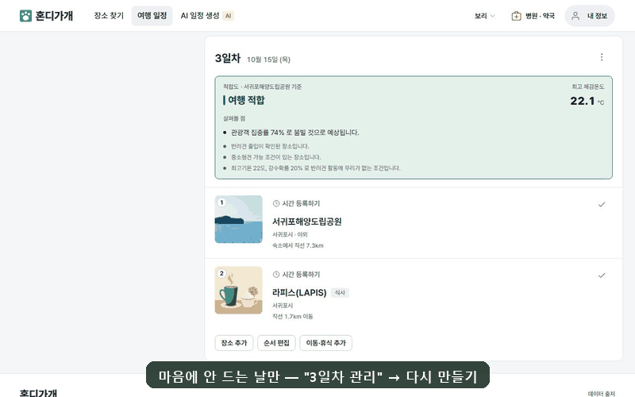

- **하루 다시 만들기** — 마음에 안 드는 날만 `N일차 관리 → 다시 만들기` 로 다시 짭니다. 다른 날은 그대로입니다.
- 바라는 것을 한 줄로 적으면(예: "바다가 보이는 산책길과 반려견 카페로 부탁해요") AI 가 그날만 다시 짜고(이번 녹화 50초), **지금 → 이렇게 바뀌어요** 를 나란히 보여 줍니다. 이번에는 라피스(LAPIS) 가 벙커하우스로 바뀌었습니다.
- **이 날 바꾸기**를 눌러야 반영됩니다.

## 8. 여행 준비물 (AI)

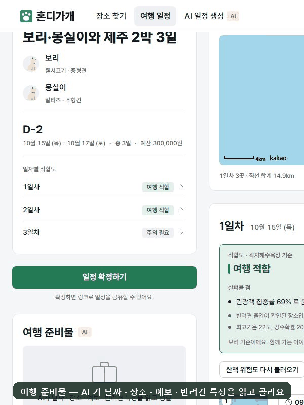

- **AI로 준비물 챙기기** — 날짜 · 장소 · 예보 · 반려견 특성을 읽고 준비물을 고릅니다(이번 녹화 32초, 6개). 모델 출력을 그대로 쓰지 않고 서버 규칙(`PackingListRules`)이 목록을 정리합니다.
- **품목마다 이유가 붙습니다.** 어느 날 · 어느 장소 때문인지까지 적습니다. 예: 물티슈 — "1일차 곽지해수욕장에서 모래를 닦아줘요", 사료와 간식 — "3일 동안 먹을 평소 사료와 간식이에요. 먹던 것이라야 배탈이 덜 나요."
- 챙긴 것은 체크하고, 필요 없는 것은 지웁니다. 빠진 것은 **직접 추가**(분류 · 이름만 적고, 이유는 AI 만 붙임)합니다.
- **다시 만들기**를 해도 직접 추가한 것과 챙김 표시는 남습니다. 여러 번 눌러도 요청은 한 번입니다(아래 따닥 점검).

## 9. 일정 확정 · 공유 링크

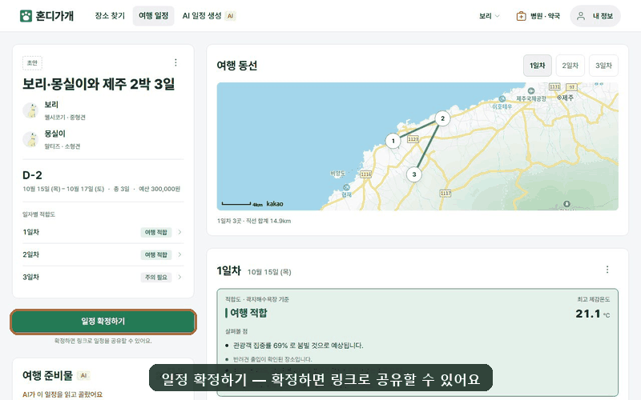

**흐름** — `일정 확정하기 → 일정 관리 → 공유 링크 → 링크 만들기 → 복사 → (받는 사람) 로그인 없이 보기`

- 확정한 일정만 공유할 수 있습니다. 링크는 **30일 동안** 열 수 있고(예: "2026년 11월 12일까지 볼 수 있어요"), 언제든 **링크 폐기**로 끊을 수 있습니다.
- 공유 화면은 **로그인 없이 읽기 전용**입니다. 일자별 시각 · 장소 · 식사 · 숙박이 보이고, **예산과 메모는 보이지 않습니다**. 공개 경로는 레이트 리밋과 로그 마스킹으로 보호합니다.

## 10. 여행 당일 브리핑

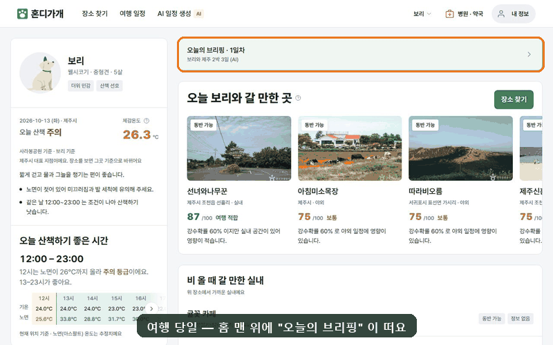

- 여행 당일에는 홈 맨 위에 **오늘의 브리핑 · N일차** 배너가 뜹니다.
- 브리핑 한 화면에 그날 정보를 모읍니다.
  - **오늘 날씨와 적합도** — 흐림 · 최고 24℃ · 강수 60% 같은 그날 날씨
  - **기상특보**
  - **산책하기 좋은 시간**
  - **오늘 일정** — 그날 일정 전체 타임라인(지금 · 다음 갈 곳 표시)과 하루 동선 지도
- 일정 상세의 "오늘의 브리핑" 칸이나 "가는 곳 주변 병원 · 약국" 으로도 들어갑니다.

## 11. 병원 · 약국

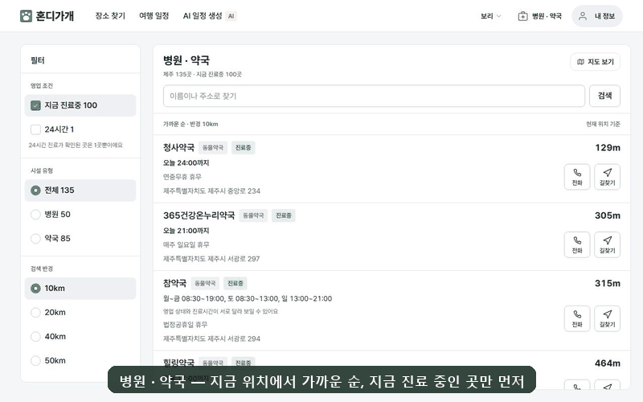

- 제주 동물병원 · 동물약국(한국문화정보원)을 **현재 위치 기준 가까운 순**으로 찾습니다. 기본은 **지금 진료 중**인 곳만입니다.
- **24시간** · 시설 유형(병원 · 약국) · 검색 반경(10~50km)으로 거르고, 행마다 거리 · 오늘 영업시간 · 전화 · 길찾기가 붙습니다.
- **지도 보기**에서 핀을 누르면 정보 패널이 뜹니다.

## 12. 제주올레 산책 코스

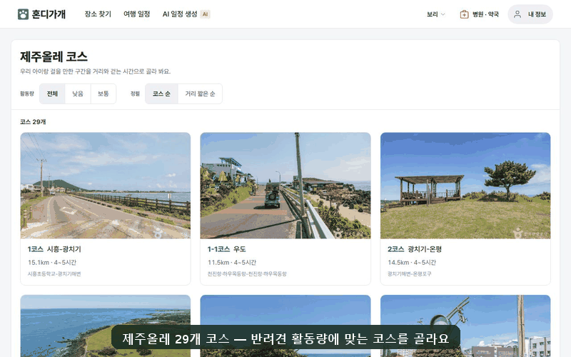

- **제주올레 29개 코스**(공공데이터포털 + TourAPI 좌표)를 **활동량**(낮음 · 보통) · **거리 짧은 순**으로 거릅니다.
- 코스 상세에는 거리 · 걷는 시간 · 시종점과 **반려견 활동량에 맞는지**가 나옵니다. **코스 시작점 지도**, 시작점 기준 **오늘 산책하기 좋은 시간**(예: 13:00–23:00 안전 등급), 시작점 근처 가볼 만한 곳도 함께 봅니다.
- **일정에 담기**로 기존 일정의 원하는 날이나 새 일정에 넣습니다.

## 13. 모바일

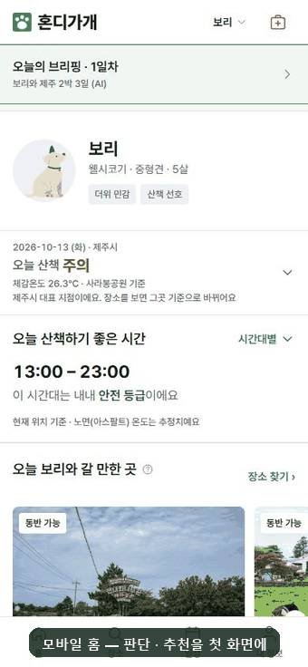

- 하단 탭(홈 · 장소 · 일정 · 내 정보)으로 움직입니다. 장소는 **지도 위 끌어 올리는 목록 시트**라, 내리면 지도를 넓게 보고 올리면 목록을 봅니다.
- 상세 화면(장소 · 일정 · 올레)에서는 하단 탭바를 숨겨 내용을 넓게 씁니다.
- 30개 화면 모두 **390px 에서 가로 넘침이 없습니다**(아래 점검).

## 14. 내 정보

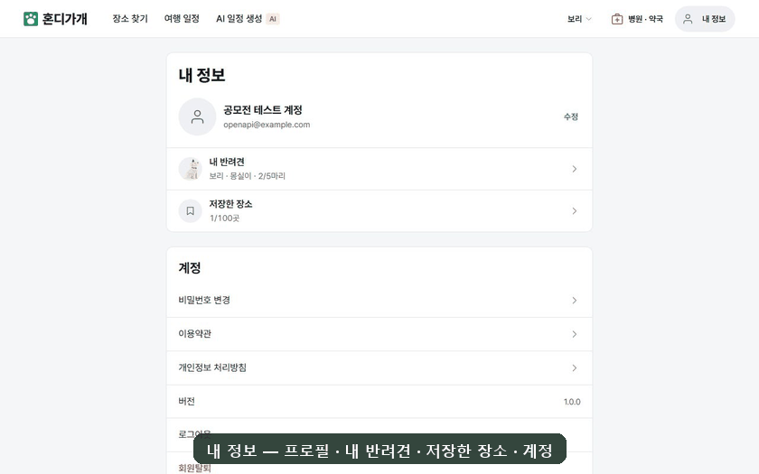

- 프로필(닉네임 · 프로필 사진) 수정, 내 반려견 · **저장한 장소** 바로가기, 비밀번호 변경(소셜 계정은 비밀번호 설정), 이용약관 · 개인정보 처리방침을 둡니다.
- **로그아웃**은 확인 창을 한 번 거치고 이 기기의 세션을 끝냅니다.
- **회원 탈퇴**는 내 정보 위 확인 모달로 진행합니다. 공모전 계정이라 이번 녹화에서는 열지 않았습니다.

---

## 운영 E2E 점검 결과 (2026-10-13)

이 문서의 GIF 를 찍은 Playwright 세션으로 운영을 점검했습니다. 데스크톱은 1280×800, 모바일은 390×844(터치)입니다.

### 화면 점검 — 30개 화면 × 데스크톱 · 모바일

홈 · 장소(지도 · 목록 · 상세 2곳) · 저장한 장소 · 반려견(목록 · 등록 · 수정) · 일정(목록 · 새 일정 · 상세 2개 · 브리핑 · 주변 병원 · 장소 추가) · AI 일정 · 병원 · 약국(목록 · 지도) · 올레(목록 · 상세) · 내 정보 · 비밀번호 · 서비스 소개 · 약관 · 개인정보 · 공유 화면 · 제주 소개 3곳을 점검했습니다.

| 항목 | 데스크톱 | 모바일 |
| --- | --- | --- |
| 콘솔 오류 · 실패한 API(4xx/5xx) | **0건** | **0건** |
| 페이지 로드 중 같은 API 중복 호출 | 0건 | 0건 |
| 가로 넘침 | 0건 | 0건 |
| 화면별 로드(networkidle) | 1.8~2.9초 | 1.8~2.5초 |

### 따닥(빠른 두 번 클릭) 점검

| 버튼 | 요청 | 결과 |
| --- | --- | --- |
| 로그인 | `POST /auth/login` | 1회 ✅ |
| 장소 저장 | `POST /favorites/places/{id}` | 1회 ✅ |
| AI 준비물 다시 만들기 | `POST /ai-plans/packing-list/{planId}` | 1회 ✅ — 10-10 dev 점검의 2회(#1338 · #1337)가 고쳐진 것을 확인 |
| 일정에 담기 시트(장소 · 올레, 데스크톱) | 시트 열림 유지 | 열린 채 유지 ✅ — #1339 고쳐짐 |

### 흐름별 실제 조작

| 흐름 | 서버에 나간 변경 요청 |
| --- | --- |
| 반려견 등록(몽실이) | `POST /members/me/pets` 1회 |
| 장소 저장 → 일정에 담기 | `POST /favorites/places/598187` · `PUT /plans/{id}/days/1/items` 각 1회 |
| AI 일정 생성 → 담기 | `POST /ai-plans`(202) · `POST /plans` 각 1회, 생성 2분 23초 |
| 시각 고치기 · 이동 · 휴식 추가 | `PUT …/items/{id}/start-time` · `PUT …/days/1/items` |
| AI 준비물 · 직접 추가 · 체크 | `POST /ai-plans/packing-list/{planId}`(32초) · `PUT …/packing-items` · `POST …/packing-items` · `PUT …/checked` |
| 하루 다시 만들기 → 반영 | `POST /ai-plans`(50초) · `PUT /plans/{id}/days/3/items` |
| 확정 → 공유 링크 | `PUT /plans/{id}` · `POST /plans/{id}/share-link` |
| 로그아웃 | `POST /auth/logout` → `/login` |

- 회원가입 인증코드 · 비밀번호 찾기 코드는 받을 수 없는 `example.com` 주소로 각 1회 발송해 화면 상태만 확인했습니다. **가입 완료 · 소셜 로그인 · 비밀번호 실제 변경 · 회원 탈퇴는 하지 않았습니다.**

### 발견한 결함

| 이슈 | 내용 |
| --- | --- |
| [#1419](https://github.com/8llow8llowMe/hondigagae/issues/1419) (BE) | 운영에서 **시각이 있는 일정 항목의 산책 위험도가 전부 "가져오지 못했습니다"** 로 나옵니다. plan → tour `walk-safety` 가 400(`INSIGHT_113`)으로 거절됩니다(운영 400 66건 · 브라우저에서 같은 장소 직접 조회는 200). GIF 의 일정 타임라인에 이 문구가 보이는 이유입니다. 장소 상세 · 홈의 산책 위험도는 정상입니다 |
| [#1420](https://github.com/8llow8llowMe/hondigagae/issues/1420) (BE) | AI 일정이 동행견 중 한 마리라도 들어갈 수 없는 장소(크기 · 체중 제한)를 넣습니다. 서버 검증이 없고 프롬프트에만 맡깁니다 |
| [#1421](https://github.com/8llow8llowMe/hondigagae/issues/1421) (FE) | 로그아웃 직후 내 정보 쿼리가 다시 돌아 401 이 3건 납니다(화면 영향 없음) |
